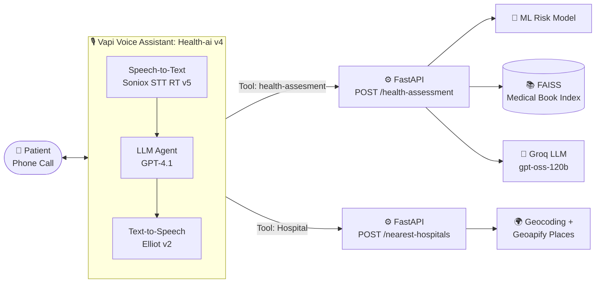

<div align="center">

# 🩺 AI Health Assistant

### A Voice-Enabled Health Risk Assessment System using Machine Learning, RAG and Vapi

*Call a number. Answer a few questions. Get your health risk level, a source-grounded answer, and nearby care options.*


**Healthcare Analytics** · Symbiosis Institute of Technology, Nagpur

</div>

---

## 📑 Table of Contents

- [Overview](#-overview)
- [Key Features](#-key-features)
- [System Architecture](#-system-architecture)
- [Tech Stack](#-tech-stack)
- [Dataset](#-dataset)
- [Machine Learning Model](#-machine-learning-model)
- [RAG Pipeline](#-rag-pipeline)
- [API Reference](#-api-reference)
- [Voice Assistant on Vapi](#-voice-assistant-on-vapi)
- [Project Structure](#-project-structure)
- [Getting Started](#-getting-started)
- [Test Call Results](#-test-call-results)
- [Limitations](#-limitations)
- [Future Scope](#-future-scope)
- [Team](#-team)

---

## 🌟 Overview

Getting preliminary health guidance usually means filling in forms, searching the web, or hunting for a nearby facility. **AI Health Assistant** removes that friction.

A person simply **phones the assistant**, answers a short series of spoken questions about their lifestyle and medical background, and receives:

| | What you get |
|---|---|
| 🎯 | A **Low / Moderate / High** health risk classification |
| 📚 | A plain-language answer to your own health question, **grounded in a 1,163-page medical book** |
| 🏥 | **Nearby healthcare facilities** from a spoken city or locality |

> ⚠️ **Disclaimer:** This is a screening and information tool. It does **not** diagnose disease, prescribe treatment, or replace a qualified clinician.

---

## ✨ Key Features

- 🎙️ **Hands-free voice interface** built on Vapi (speech-to-text, LLM, text-to-speech)
- 🧠 **ML risk prediction** from 9 easily obtained inputs
- 🔍 **Explainable results** with SHAP-based top contributing factors
- 📖 **Retrieval-Augmented Generation** so answers come from a trusted source, not just LLM memory
- 🗺️ **Hospital finder** using geocoding and a places API
- ⚡ **Clean REST API** with automatic interactive docs at `/docs`

---

## 🏗️ System Architecture



The system has three layers:

1. **Interaction layer:** the Vapi assistant `Health-ai` talks to the caller.
2. **Service layer:** a FastAPI app exposes the backend logic as REST endpoints.
3. **Intelligence and data layer:** the risk model, FAISS index, Groq LLM, and external location APIs.

---

## 🧰 Tech Stack

| Layer | Technology | Purpose |
|---|---|---|
| 🎙️ Voice platform | **Vapi** (`Health-ai` v4) | Phone assistant, call logs, tool config |
| 👂 Speech-to-text | **Soniox STT RT v5** | Real-time transcription (~410 ms, 1.8% WER) |
| 💬 Conversation model | **GPT-4.1** (OpenAI) | Drives dialogue, decides when to call tools |
| 🔊 Text-to-speech | **Elliot v2** (Vapi) | Speaks replies to the caller |
| ⚙️ Backend | **FastAPI, Uvicorn, Pydantic** | REST API, validation, auto docs |
| 🧠 Machine learning | **scikit-learn 1.7.2, XGBoost, LightGBM, CatBoost, joblib** | Risk classification and score regression |
| 🔍 Explainability | **SHAP** (optional) | Per-patient factor contributions |
| 🔗 RAG orchestration | **LangChain** (`RetrievalQA`) | Retriever + prompt + LLM |
| 🧬 Embeddings | `all-MiniLM-L6-v2` | Dense vectors for text chunks |
| 🗄️ Vector store | **FAISS** (`faiss-cpu`) | Similarity search over the medical book |
| 🤖 RAG language model | **Groq** `openai/gpt-oss-120b` (temp 0.5) | Grounded answer generation |
| 📄 PDF parsing | **pdfplumber** | Text extraction from 1,163 pages |
| 📍 Location | **geocode.maps.co + Geoapify Places** (via `httpx`) | Place name → coordinates → nearby facilities |

---

## 📊 Dataset

`dataset.csv` holds **1,000 records**, **9 input attributes**, and one original label.

| Attribute | Type | Observed values |
|---|---|---|
| Age | Numeric | 18 to 79 |
| Gender | Categorical | Male, Female, Other |
| BMI | Numeric | about 10.6 to 39.8 |
| Smoking Status | Categorical | Never (350), Current (335), Former (315) |
| Alcohol Consumption | Numeric | up to 19 drinks/week |
| Physical Activity | Numeric | up to 10 hours/week |
| Sleep Duration | Numeric | up to 11.7 hours/day |
| Chronic Disease History | Categorical | None (235), Diabetes (257), Heart Disease (254), Hypertension (254) |
| Stress Level | Numeric | 1 to 10 |

> 💡 `"None"` in *Chronic Disease History* is a real category, so the data is read with `keep_default_na=False`.

---

## 🧠 Machine Learning Model

### Why a rule-based target?

The dataset's original `Health Risk Level` label agrees with the rule-based level in only **33.9%** of records, which is random-guess level. It is therefore **not used** as the training target. Instead, a transparent additive points system (0 to 100) built from common risk-factor cut-offs is used.

<details>
<summary><b>📋 View the full scoring table</b></summary>

| Factor | Rule and points |
|---|---|
| Age | <40: 0 · 40-54: 5 · 55-64: 10 · 65+: 15 |
| BMI | <18.5: 5 · 18.5-24.9: 0 · 25-29.9: 5 · 30-34.9: 10 · 35+: 15 |
| Smoking | Never: 0 · Former: 5 · Current: 15 |
| Alcohol / week | up to 7: 0 · 8-14: 5 · above 14: 10 |
| Activity (h/week) | 2.5+: 0 · 1 to <2.5: 5 · <1: 10 |
| Sleep (h/day) | 7-9: 0 · 6 to <7 or >9 to 10: 5 · otherwise: 10 |
| Stress (1-10) | 1-3: 0 · 4-6: 5 · 7-10: 10 |
| Chronic disease | None: 0 · Hypertension: 10 · Diabetes: 12 · Heart Disease: 15 |

</details>

| Risk level | Score | Cases (1,000 records) |
|---|---|---|
| 🟢 Low | 34 or below | 244 |
| 🟡 Moderate | 35 to 49 | 420 |
| 🔴 High | 50 and above | 336 |

### Training setup

- Cleaning: standardised column names, median/mode imputation, duplicate removal, implausible-row filtering
- Preprocessing: `ColumnTransformer` (scaled numerics + one-hot categoricals)
- Split: **80/20 stratified** (800 train / 200 test, seed 42)
- Evaluation: **5-fold stratified cross-validation**, best model chosen by macro-F1 (classifiers) or MAE (regressors)

### 📈 Results

**Classification (test set)**

| Model | CV Accuracy | CV Macro-F1 | Test Accuracy | Test Macro-F1 |
|---|---|---|---|---|
| Logistic Regression | 0.784 | 0.786 | 0.815 | 0.814 |
| Random Forest | 0.758 | 0.760 | 0.805 | 0.804 |
| XGBoost | 0.798 | 0.802 | 0.810 | 0.811 |
| **Weighted Ensemble** ⭐ | **0.800** | **0.803** | **0.840** | **0.838** |

**Regression (0 to 100 risk score)**

| Model | CV MAE | R² (test) | MAE (test) |
|---|---|---|---|
| Random Forest | 4.58 | 0.855 | 3.88 |
| **XGBoost** ⭐ | **2.03** | **0.974** | **1.66** |

No High case was predicted as Low, and no Low case as High. Most errors fall between neighbouring categories.

> ℹ️ High accuracy shows the scoring rules are learnable from the inputs. It does **not** mean real clinical outcomes are predicted.

---

## 📚 RAG Pipeline

**Built once (lazily, thread-safe):**

```
Medical_Book.pdf (1,163 pages)
   → pdfplumber text extraction
   → RecursiveCharacterTextSplitter (chunk 150, overlap 25)
   → all-MiniLM-L6-v2 embeddings
   → FAISS index saved to vectorstore/
```

**At query time:**

```
Patient details + predicted risk + question
   → retriever (top k = 3 chunks)
   → prompt template
   → Groq gpt-oss-120b (temperature 0.5)
   → grounded answer
```

🛡️ **Guard rail:** if a question is unrelated to the retrieved context, the model replies with a fixed *"I don't know the answer to that question based on the provided information"* message instead of inventing one.

---

## 🔌 API Reference

| Method | Endpoint | Description |
|---|---|---|
| `GET` | `/` | Health check |
| `POST` | `/health-assessment` | Predict risk level and answer the question via RAG |
| `POST` | `/nearest-hospitals` | Find healthcare facilities near a location |

Interactive docs are available at **`/docs`** once the server is running.

### `POST /health-assessment`

```json
{
  "Age": 45,
  "Gender": "Male",
  "BMI": 27.5,
  "SmokingStatus": "Former",
  "AlcoholConsumptionPerWeek": 4,
  "PhysicalActivityHoursPerWeek": 3,
  "SleepDurationHoursPerDay": 6.5,
  "ChronicDiseaseHistory": "Hypertension",
  "StressLevel": 6,
  "question": "How can I lower my risk?"
}
```

All fields are required. Invalid bodies return a standard **HTTP 422** validation error.

### `POST /nearest-hospitals`

| Field | Default | Notes |
|---|---|---|
| `location` | none | City or locality name |
| `radius` | `5000` | Search radius in metres |
| `max_results` | `5` | Capped at 20 |

The location is geocoded via **geocode.maps.co**, then **Geoapify Places** is queried for the healthcare category. Each result includes name, address, city, state, postcode, distance (m), coordinates and place ID.

---

## 🎙️ Voice Assistant on Vapi

**Assistant:** `Health-ai` (v4, Published, "Balanced" preset). It speaks first and collects one value at a time, confirming each.

| Component | Selection | Latency | Cost |
|---|---|---|---|
| Transcriber | Soniox STT RT v5 | 410 ms | $0.004/min |
| Model | GPT-4.1 | 690 ms | $0.02/min |
| Voice | Elliot v2 | 430 ms | $0.02/min |
| **Total (estimate)** | Full pipeline | **~1,530 ms** | **~$0.09/min** |

**Tools (type: API request):**

- `health-assesment` → called after all 9 details and the final question are collected → `POST /health-assessment`
- `Hospital` → called when the caller needs nearby care → `POST /nearest-hospitals`

### 🔄 End-to-end flow

1. 📞 Caller dials the Vapi number; the assistant greets and asks for age
2. 🗣️ Answers are transcribed and the next missing detail is requested until all 9 values are collected
3. ❓ The assistant asks for the caller's health question
4. 📡 The `health-assesment` tool sends everything to the backend
5. 🧠 Backend predicts risk, retrieves 3 chunks, and generates a grounded answer
6. 🔊 The reply is phrased conversationally and spoken aloud
7. 🏥 On request, the `Hospital` tool geocodes the location and returns the closest named facilities

---

## 📁 Project Structure

```
├── main.py              # FastAPI backend: model loading, RAG, endpoints
├── model                # Training script: cleaning, scoring, training, SHAP, predict helper
├── dataset.csv          # 1,000-row lifestyle and health dataset
├── Medical_Book.pdf     # 1,163-page reference used as the RAG knowledge base
├── requirements.txt     # Python dependencies
└── photos/              # Screenshots of FastAPI docs and the Vapi dashboard
```

---

## 🚀 Getting Started

### Prerequisites

- Python 3.10+
- API keys for **Groq**, **geocode.maps.co** and **Geoapify**
- A **Vapi** account (for the voice assistant)

### Installation

```bash
# 1. Clone the repository
git clone https://github.com/MUKUNDKUTHE/A-Voice-Enabled-Health-Risk-Assessment-System-using-Machine-Learning-RAG-and-Vapi.git
cd A-Voice-Enabled-Health-Risk-Assessment-System-using-Machine-Learning-RAG-and-Vapi

# 2. Install dependencies
pip install -r requirements.txt
```

### Configuration

Create `secret_api_keys.py` next to `main.py`:

```python
groq_api_key = "your-groq-key"
geocoding_api_key = "your-geocode-maps-co-key"
geoapify_api_key = "your-geoapify-key"
```

> 🔐 Never commit this file. Add it to `.gitignore`.

### Train the model

Run the training script on `dataset.csv` to produce `health_risk_model.joblib`, and place it next to `main.py`.

### Run the server

```bash
uvicorn main:app --reload
```

Then open **http://127.0.0.1:8000/docs** to try the endpoints. The first call to `/health-assessment` builds the FAISS vector store, so expect it to be slower once.

### Connect Vapi

1. Expose the server on a **public HTTPS URL** (for example with a tunnel or a hosted deployment)
2. Point the `health-assesment` tool at `/health-assessment`
3. Point the `Hospital` tool at `/nearest-hospitals`
4. Call your Vapi number and talk to the assistant

---

## 🧪 Test Call Results

A real inbound call to the assistant was recorded on the Vapi dashboard.

| Item | Value |
|---|---|
| Call type | Inbound phone call |
| Date | 23 September 2026 |
| Assistant | Health-ai (v4) |
| Duration | 4 minutes |
| Cost | $0.32 |
| Log entries | 4,567 |

The transcript confirmed the intended one-question-at-a-time flow (greeting, then age, then gender), and the logs showed the real-time speech pipeline working for each turn.

---

## ⚠️ Limitations

- **Screening, not diagnosis.** The risk level reproduces a rule-based scheme and is not clinically validated.
- **Weak original label.** The dataset's own label shows no meaningful relation to its features.
- **Model artifact consistency.** `main.py` expects keys `model` and `label_encoder` and original column names, while the training script saves `classifier` and `regressor` with renamed columns. Align these before deployment.
- **Small retrieval chunks.** 150-character chunks with k = 3 can give thin context.
- **Broad facility search.** Results can include clinics and pharmacies as well as hospitals.
- **Code hygiene.** `HospitalRequest` is defined twice, hospital routes sit after the `__main__` block, and API keys come from a separate file instead of environment variables.
- **Security.** CORS allows all origins and endpoints have no authentication.

---

## 🔭 Future Scope

- [ ] Train on real, clinically labelled data and validate with medical professionals
- [ ] Add emergency detection (for example chest pain triggers an instruction to call emergency services)
- [ ] Support Hindi, Marathi and other regional languages
- [ ] Improve retrieval with larger section-aware chunks, re-ranking and source citations
- [ ] Add authentication, rate limiting, consent handling and secure call-data storage
- [ ] Filter facilities by type and include directions and phone numbers

---

## 👥 Team

| Name | PRN |
|---|---|
| **Mukund Kuthe** | 23070521082 |
| **Manasvi Puranik** | 23070521090 |

**Subject:** Healthcare Analytics  
**Faculty Guide:** Dr. Prerna Mishra  
**Institute:** Symbiosis Institute of Technology, Nagpur (Symbiosis International, Deemed University)

---

<div align="center">

*Built with ❤️ for better access to health guidance.*

</div>
